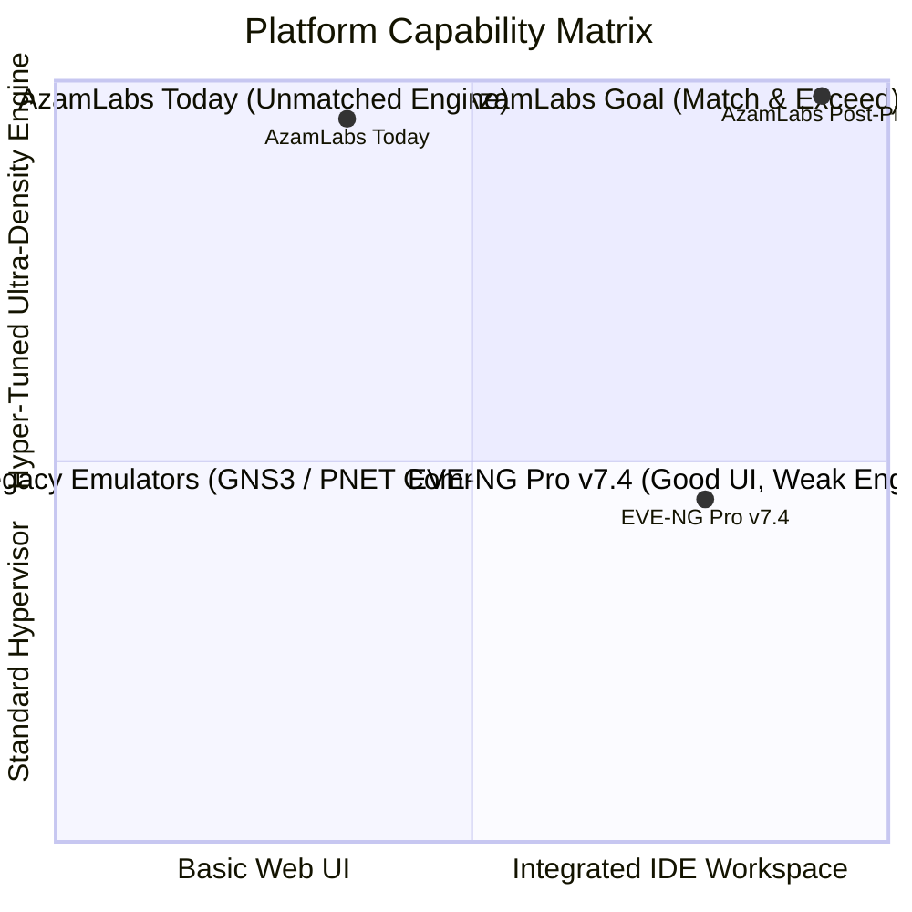
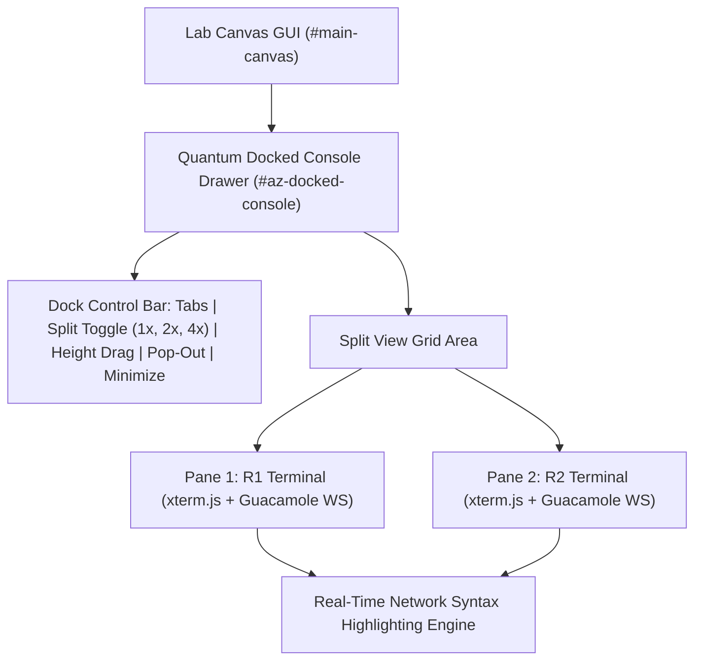
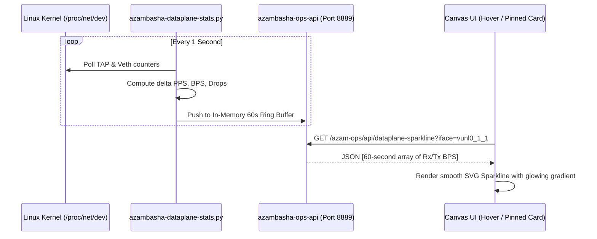

# AzamLabs vs EVE-NG Pro v7.4: Architectural Analysis & "Match & Exceed" Implementation Plan

*Authoritative Engineering Reference & Blueprint* | *Date: October 2026* | *Platform: Ubuntu 26.04 Resolute LTS (AzamLabs v6.8.92)*

---

## 1. Executive Summary & Competitive Context

In late October 2026, EVE-NG announced **EVE-NG Professional v7.4**, skipping incremental point versions to introduce a major UI/UX overhaul. Rather than upgrading the underlying hypervisor engine, v7.4 focused almost entirely on the **operator console experience and workspace ergonomics**:
1. **Integrated Docked Consoles**: Moving away from annoying browser pop-up windows by docking terminals directly into the lab canvas with split-screen and draggable tabs.
2. **Terminal Syntax Highlighting**: Applying real-time color formatting to CLI output (IPs, interfaces, routing states).
3. **Decoupled Architecture**: Eliminating Apache Tomcat, the Guacamole MySQL database, and the resource-heavy Netdata daemon.
4. **Per-Node/Link Telemetry**: Native 1-second sampling and 1-hour throughput history.

### Strategic Assessment: Where Does AzamLabs Stand?
- **The Core Hypervisor Engine**: **AzamLabs dominates EVE-NG Pro.** AzamLabs delivers **Ultra-KSM 4KB RAM deduplication (65% to 80%+ memory savings)**, the **dynamic Cisco IOL C-shim (<64MB RAM/router)**, the **3-tier Anti-Bootstorm Staggering Engine**, the **AI Lab Architect Copilot**, the **Silicon Dataplane (MTU 9000 RoCEv2 RXE)**, and **100% Free, Unlimited Node Scaling with Zero Cloud Licensing Locks**.
- **The Modern UI/UX Gap**: EVE-NG v7.4 correctly identified that network engineers hate juggling 20 pop-up browser tabs. AzamLabs currently opens HTML5 sessions in new browser tabs via `window.open()`.
- **The Goal of this Implementation Plan**: Adopt all 3 marquee usability pillars from EVE-NG v7.4, integrate them cleanly with our existing high-density backend, and **exceed** EVE-NG by offering a superior, ultra-low-latency, pure-dark IDE workspace.

---

## 2. Competitive Scorecard: AzamLabs vs. EVE-NG Pro v7.4

| Subsystem / Capability | EVE-NG Pro v7.4 | AzamLabs v6.8.92 (Current) | AzamLabs Post-Implementation (Exceeding EVE-NG) |
| :--- | :---: | :---: | :---: |
| **Console Windowing** | Docked, floating, split views | Sequenced Staggered Pop-ups | **Quantum In-Canvas Docked Console (1, 2, 4-way split, floating tabs)** |
| **CLI Formatting** | Regex syntax highlighting | Standard monochrome terminal | **Network-Aware Syntax Engine (IPs, Interfaces, States, Protocols)** |
| **Link & Node Telemetry** | 1s polling, 1h history | CLI/REST telemetry exporter | **Hover/Inspect SVG Micro-Sparklines (Rx/Tx, PPS, Drops, Latency)** |
| **RAM Optimization** | Standard Linux KSM (15–25%) | **Ultra-KSM (65–80% savings)** | **Ultra-KSM + C-Shim (<64MB IOL)** |
| **Bootstorm Protection** | None (CPU/IO lockups) | **3-Tier Dynamic Staggering** | **3-Tier Dynamic Staggering + Console Prompt Probing** |
| **AI Lab Builder** | None | **AI Copilot (Ollama / Cloud LLM)** | **AI Copilot + In-Canvas Voice/Chat Assist** |
| **Dataplane Networking** | Standard Linux Bridges | **Silicon Dataplane (RoCEv2 RXE)** | **MTU 9000 Zero-Fragmentation Cluster Mesh** |
| **Licensing & Cost** | Paid subscription ($$$); 7-node cap | **100% Free; Unlimited Nodes** | **100% Free; Unlimited Nodes; 100% Air-Gapped** |

---

## 3. The "Match & Exceed" Blueprint: 3 Core Pillars

### Pillar 1: In-Canvas Docked Terminal Console (Zero Pop-Up Tabs)

#### The Problem It Solves
Currently, clicking a node in HTML5 mode triggers `window.open('/html5/#/client/...', '_blank')`. In a 20-router lab, the browser is overwhelmed with 20 disparate tabs, triggering browser throttling, pop-up blockers, and constant context switching.

#### The AzamLabs "Exceed" Architecture
Build a responsive, collapsible **Bottom Console Dock** (`#az-docked-console`) directly injected into the active lab canvas:
1. **Multi-Pane Layouts**:
   - **Single View**: Focused single terminal with top tab-strip.
   - **Dual Split (50/50)**: Compare two nodes side-by-side (e.g., R1 on the left, R2 on the right) for OSPF/BGP peering troubleshooting.
   - **Quad Grid (2x2)**: Monitor 4 core routers simultaneously.
2. **Draggable & Resizable**: Drag the top divider to adjust height (from 20% to 85% of viewport); 1-click minimize to a sleek status bar or maximize to fullscreen.
3. **Tab Strips with Device Icons**: Each tab displays device hostname, vendor logo/color (Cisco blue, Juniper cyan, Arista orange), and active session heartbeat.
4. **Detachable Pop-Out**: A 1-click button to detach any tab into a standalone window when multi-monitor setups require it.

---

### Pillar 2: CLI Real-Time Network Syntax Highlighting Engine

#### The Problem It Solves
Raw router outputs (`show ip bgp summary`, `show ip interface brief`, `show run`) output plain white text. Scanning 50 interface states or matching IPv4/IPv6 addresses causes eye fatigue.

#### The AzamLabs "Exceed" Architecture
A client-side tokenizing stream parser hooked into the terminal pipeline before rendering to the DOM canvas:
1. **Network Regular Expression Dictionary**:
   - **IPv4 Addresses & Subnets**: `\b(?:\d{1,3}\.){3}\d{1,3}(?:/\d{1,2})?\b` $\rightarrow$ Electric Cyan (`#38bdf8`) with subtle bold.
   - **IPv6 Addresses**: `\b[0-9a-fA-F:]{4,39}(?:/\d{1,3})?\b` $\rightarrow$ Sky Blue (`#60a5fa`).
   - **Interface Identifiers**: `(GigabitEthernet|FastEthernet|TenGigE|Eth|Gi|Fa|Te|lo|vlan|xe-|ge-)\d+[\d/.]*` $\rightarrow$ Violet/Purple (`#c084fc`).
   - **Positive Operational States**: `(up|UP|Established|FULL|Connected|Active|Success|Forwarding|200 OK)` $\rightarrow$ Emerald Green (`#22c55e`).
   - **Negative Operational States**: `(down|DOWN|administratively down|Admin Down|Failed|Error|Drop|Reset|Idle|Active|BGP state: Active)` $\rightarrow$ Crimson Red (`#ef4444`).
   - **Routing Protocols & ASNs**: `(OSPF|BGP|EIGRP|IS-IS|MPLS|LDP|VXLAN|EVPN|AS \d+)` $\rightarrow$ Amber Yellow (`#f59e0b`).
2. **Zero-Latency Stream Parser**: Operates as a fast pass-through stream filter using ANSI escape sequences (`\x1b[38;2;R;G;Bm`), ensuring **zero input lag** during rapid terminal scrolling or `show tech-support`.
3. **User Theme Customization**: Pre-calibrated palettes: *Cyberpunk Pure Black*, *Solarized Dark*, *Dracula*, and *High Contrast Lab*.

---

### Pillar 3: Per-Node & Per-Link Live Dataplane Sparklines

#### The Problem It Solves
Troubleshooting packet drops or verifying QoS traffic burst generators traditionally requires running `tcpdump` or launching Wireshark. Engineers lack instant visual confirmation of link traffic.

#### The AzamLabs "Exceed" Architecture
Leverage our existing **[`scripts/azambasha-dataplane-stats.py`](file:///e:/AzamLabs/scripts/azambasha-dataplane-stats.py)** daemon to feed high-speed live micro-charts into the canvas:
1. **High-Speed Ring Buffer Backend**:
   - `azambasha-ops-api.py` exposes `/azam-ops/api/dataplane-sparkline?iface=<IFACE_NAME>`.
   - Maintains a 60-second in-memory ring buffer (1-second granularity) of:
     - Rx / Tx Throughput (Kbps / Mbps)
     - Packets Per Second (PPS)
     - Errors & Drops (CRC / Buffer drops)
2. **Interactive SVG Micro-Sparklines on Canvas**:
   - **Hovering over any link**: An interactive HUD card pops up displaying:
     - Real-time animated SVG sparkline chart (Green = Tx, Cyan = Rx).
     - Live throughput counters (`34.2 Mbps ↑ / 12.8 Mbps ↓`).
     - Real-time packet drops (`0 drops / 0 errs`).
   - **Right-Click Interface Menu**: Option to "Pin Sparkline to Canvas", keeping a live mini-graph pinned directly over the link or next to the router node.
3. **Integration with Traffic Burst Injector**:
   - When injecting synthetic traffic bursts via `azambasha-link-impairment.sh`, the sparkline dynamically renders the traffic surge in real time!

---

## 4. Phased Implementation Roadmap

### Phase 1: Dataplane Sparkline Telemetry API
- **Target File**: [`scripts/azambasha-ops-api.py`](file:///e:/AzamLabs/scripts/azambasha-ops-api.py)
- **Actions**:
  1. Add background sampling thread polling `/proc/net/dev` every 1000ms.
  2. Implement in-memory 60-entry sliding window dictionary indexed by interface (`vnet*`, `vunl*`, `pnet*`).
  3. Register endpoint `/azam-ops/api/sparkline?iface=<id>` returning JSON timestamps and metrics.
  4. Ensure zero disk writes (all in RAM) to eliminate SSD wear.

### Phase 2: In-Canvas Docked Console Drawer
- **Target File**: [`html/azam-ops/azamlabs-sequenced-console.js`](file:///e:/AzamLabs/html/azam-ops/azamlabs-sequenced-console.js) & [`html/themes/default/js/azamlabs-docked-console.js`](file:///e:/AzamLabs/html/azam-ops/azamlabs-features.js)
- **Actions**:
  1. Construct `#az-docked-console` DOM container with top resizer handle.
  2. Implement layout switcher: `Single Pane`, `Dual Split (Left/Right)`, `Quad Grid (2x2)`.
  3. Modify `openSingleConsole(node)`: If user setting `console_docked === true`, route session into docked iframe rather than `window.open()`.
  4. Implement session tab manager: Add Tab, Close Tab, Duplicate, Maximize/Minimize.

### Phase 3: Real-Time Network CLI Syntax Parser
- **Target File**: `html/themes/default/js/azam-cli-syntax.js`
- **Actions**:
  1. Compile lightweight regular expression tokenizer.
  2. Hook WebSocket terminal receive buffer.
  3. Inject ANSI true-color escape codes before rendering to xterm.js canvas.
  4. Add setting toggle in console header: `[🎨 Syntax: ON/OFF]`.

### Phase 4: Canvas Hover Sparkline & HUD Integration
- **Target File**: [`html/azam-ops/azamlabs-features.js`](file:///e:/AzamLabs/html/azam-ops/azamlabs-features.js)
- **Actions**:
  1. Hook canvas link mouseenter / mouseleave events.
  2. Construct floating cyber-card `#az-link-hud` containing SVG path element.
  3. Fetch sparkline array and draw smooth cubic bezier curve.
  4. Update bandwidth chips dynamically.

### Phase 5: Cluster Testing & Verification
- **Actions**:
  1. Execute unit and syntax tests (`tests/test_javascript_syntax.py`, `pytest`).
  2. Deploy to Master (`192.168.1.23`) and verify live browser rendering.
  3. Deploy to Satellite (`192.168.1.18`) for remote node console validation.

---

## 5. Non-Regression Safeguards & Future-Install Immunity

To guarantee that new VM installations from scratch deploy without syntax errors or broken dependencies:
1. **Additive Hook Architecture**: All enhancements are isolated into modular JavaScript files (`azamlabs-docked-console.js`, `azam-cli-syntax.js`) without overwriting core upstream legacy code.
2. **Toggleable Fallback**: Users retain a 1-click toggle in the header to switch between `Docked Console` and traditional `Pop-up Windows` / `SecureCRT Native`.
3. **Zero External Dependencies**: All SVG sparklines and syntax parsing use vanilla JavaScript and native browser APIs—zero bulky Node/NPM dependencies.
4. **Authoritative Master-Satellite Parity**: Symlinked through `/opt/unetlab/` and versioned in Git.
